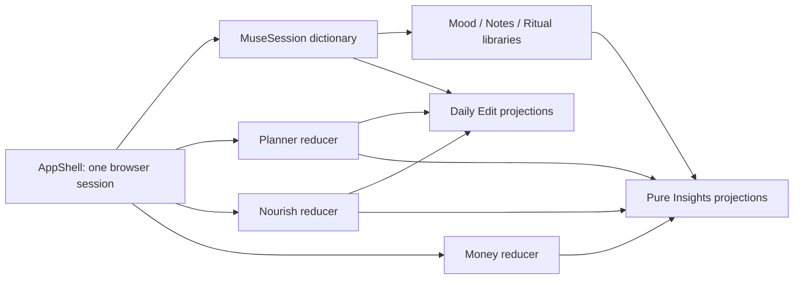

# Muse architecture audit

Audit date: 2026-10-30. Status: **repository evidence, not a persistence implementation**. Read with [DATABASE_BLUEPRINT](DATABASE_BLUEPRINT.md), [PRODUCT_RULES](PRODUCT_RULES.md), [FEATURE_SPEC](FEATURE_SPEC.md) and [WHIMSY_ROADMAP](WHIMSY_ROADMAP.md). The blueprint is a proposal requiring approval; the daily/session distinction is already approved. Latest explicit layout corrections supersede earlier header-Forecast placement instructions.

## Executive assessment

Muse is a functional, connected **single-browser-session prototype**, not yet a private production application. Tasks/events, meals, Money and Rituals have shared owners; Mood capture and Daily Edit read the same emotional records. Refresh discards domain edits. There is no database, Supabase client, authenticated ownership, route protection, remote search, persistent journal history or cross-device synchronization. Preference persistence must not be mistaken for data persistence.

The highest-risk mismatch is Day Pulse: the interface represents a day, but Energy, Stress and Overall Day still live on Morning/Evening emotional records. Daily Edit does not maintain a competing rating store; it inherits the selected session. Dayprint attributes values to sessions. Insights currently computes a daily mean of session scores for its trend, which is **an existing aggregation, not an approved authoritative daily score or migration rule**. Preserve both original observations until the user decides how to resolve conflicts. No consolidation occurs in this UI pass.

Other gaps: priorities are independent editable strings with no optional Planner links or Dayprint projection yet; water has no Nourish surface/owner yet; Daily Edit intentionally has no Rituals or Money widget; several modules lack complete record lifecycle operations. Current memory sharing proves component integration, not durable consistency.

## Evidence and runtime boundaries

| Boundary | Observed implementation | Consequence |
|---|---|---|
| Framework | [package.json](../package.json), [next.config.ts](../next.config.ts): Next 16.4.3 / React 19.3, strict TypeScript, Cache Components/partial prefetching, Turbopack/Tailwind transform | Follow installed `node_modules/next/dist/docs`, not old routing/auth snippets. Do not cache authenticated private data across users. |
| Routes | Fixed `app/*/page.tsx` destinations; `/login-preview` is a design preview; `/whimsy` is Coming Soon | No dynamic placeholder routing, API handlers, auth callback, Proxy or server mutation boundary exists. |
| Lifetime | [AppShell](../components/AppShell.tsx#L30) wraps root providers above route changes; [MuseSession](../components/MuseSession.tsx#L5) stores a generic memory dictionary | Route transitions retain changes; refresh/restart loses them. No user/account boundary exists. |
| Owners | Planner/Nourish/Money reducers; Rituals/Mood/Notes through named MuseSession libraries | One current memory owner per domain, no external authoritative copy. Generic dictionary is prototype infrastructure, not the proposed database schema. |
| Dates | [dates.ts](../lib/dates.ts#L1), [mock-profile](../lib/mock-profile.ts): date-only UTC-noon arithmetic, local-day formatting via a profile IANA zone | Selected date begins at sample 2026-10-29, not a persisted personal preference. Capture timestamp and local calendar identity are different. |
| Seeds | [daily-session-seed](../lib/daily-session-seed.ts), domain `*-sample.ts` fixtures | Fictional demonstration values must not be imported into a real account as personal history. Mood starts empty. |
| Browser storage | `muse.theme`, `muse.material`, `muse.magic`, `muse.notes.panes`, `muse-cosmic-preferences` | Preference custom/storage events synchronize preferences across tabs only. Not domain synchronization or an offline queue. |
| Integrations | [cosmic-forecast](../lib/cosmic-forecast.ts), `useCosmicPreferences` | Forecast provider contract and bounded memory cache exist; current provider is unavailable. No connected horoscope API, bank feed, weather, auth or backend was found. No new API is needed for the layout correction. |
| Tests | [tests](../tests), package scripts | Pure reducer/analytics tests and markup checks cover prototype behavior. They do not prove RLS, durable storage, concurrency, network recovery or visual quality. |

## Module inventory and lifecycle

All domain rows below are **implemented with temporary memory state**, unless marked partial, sample-only or planned. None survives refresh. “Working” means local handlers exist, not production readiness. This is the compact field inventory; the blueprint maps fields to typed tables and constraints.

### Daily Edit

Evidence: [DailyEdit](../components/DailyEdit.tsx), [daily-edit-data](../lib/daily-edit-data.ts), [PrioritiesCard](../components/PrioritiesCard.tsx#L29), [MuseSession](../components/MuseSession.tsx#L22).

- Entities: per-date priorities `{id,title,complete}` (max three); intention string; nullable intention emoji; ordered 0–3 Day in Three strings; movement type IDs; water aggregate; canonical tasks/events and meal assignments; emotional sessions. Greeting/profile/mantra are presentation/reference data.
- Creation: fixture priorities only; no priority-add UI on blank days. Intention, emoji and Day in Three create their own date-keyed memory entries. Other captures use the owners listed below.
- Read/update: inline titles/completion, intention typing, native emoji selection and confirmed Day in Three write existing date keys. No completion timestamp or linkage on priority records. No independent priority delete/reorder editor.
- Historical information: date-keyed values within this session only. `mockDay` uses the fixture only on its date; root seed explicitly registers movement/water/intention for analytics rather than fabricating prior days. Legacy `dailyEditSample.mood` and schedule fixture fields are not the live canonical Mood/Planner owners.
- Derived: priority count, water progress, bounded agenda, known meal macro sums. Approved target: dated expression/daily Pulse plus durable daily commitments with optional canonical Planner links, never a second task copy. Priorities must also appear in Dayprint even without a Mood session; this projection is not implemented yet.

### Planner

Evidence: [models](../lib/models.ts), [planner reducer and filters](../lib/planner.ts#L9), [PlannerStore](../components/PlannerStore.tsx), [ScheduleCard](../components/ScheduleCard.tsx#L33), [Planner](../components/planner/Planner.tsx).

- Task: stable ID, title, complete/completedAt, workspace/group, tag IDs, planned/due dates, optional local time slot/detail/notes, estimated and actual minutes, subtasks, creation timestamp, optional recurrence metadata. Workspace `{id,name,accent,icon?}`; group also workspaceId; tag similar independent classification. Event: separate ID/title/date/local dateTime/display time/detail; no task completion semantics.
- Create: Task List capture, day capture, Daily Edit task/event editors. Read: three-day board, unscheduled rail, Task Details, Daily agenda and Insights. Update/delete: task details/reducer; move/place preserves completion, reorders source array; workspace/group/tag managers. Event creation exists, **equivalent event edit/delete lifecycle is incomplete**.
- Timer: one active task timer in memory, wall-clock `startedAt`, pauses accumulate actualMinutes; start another task pauses the previous timer; task completion/delete pauses it. No durable time sessions or resumable server timer. Current total does not explain which date time was spent.
- Org guards prevent a task/group crossing workspaces, deleting occupied/last workspace; deleting group/tag clears references. Reducer checks are useful but not uniform server-grade validation. Recurrence is metadata, not a generation engine. Array order is not a durable concurrent ordering scheme.
- Search is client title filtering, scoped by workspace/group/tags/status/time. Future owner: tasks + classifications + separate events/time records; Daily Edit remains a bounded query.

### Rituals

Evidence: [rituals](../lib/rituals.ts#L8), [RitualStore](../components/rituals/RitualStore.tsx), [Rituals UI](../components/rituals/Rituals.tsx).

- Groups: ID/name/accent/icon/collapsed/optional gradient. Definitions: ID/name/group/type (checkbox, numeric, duration, weekly-target), goal/unit, daily/weekly/specific-weekday recurrence, startDate/createdAt. Entry: stable ID/ritualId/date/value/optional explicit missed outcome/updatedAt.
- Create/edit groups/definitions in managers; entry popovers edit historical scheduled days. Zero/explicit missed differs from clear/remove, unknown, not scheduled and upcoming. Future entries and unscheduled daily logs are rejected. Weekly targets count weekly quantities, not seven daily obligations.
- Definition schedule/type/goal/start date lock after logging; only name/group remain editable, protecting this prototype's history. Group deletion requires empty/another group. **No ritual-delete lifecycle currently exists**. Collapse and celebratedMilestones are UI preferences/playback suppression, not adherence facts.
- Derived: recurrence-aware streaks, daily/weekly denominators, progress rings/group summaries. No naive calendar-day streak or inferred failure on unscheduled days. Insights consumes library state; Daily Edit has no rituals widget yet.
- Future owner: versioned ritual definitions/schedules and dated entries; archive rather than erase historical definitions. Define missed-versus-unknown analytics explicitly.

### Nourish

Evidence: [nourish](../lib/nourish.ts#L5), [NourishStore](../components/NourishStore.tsx), [MealEditor](../components/nourish/MealEditor.tsx), [MealsCard](../components/MealsCard.tsx), [water](../lib/water.ts).

- Saved meal: ID/name/types/note/link/createdAt/optional calories, protein, carbs, fat. Assignment: ID/local date/slot/title/savedMealId?/legacy recipeId/null/optional nutrition/note/order/createdAt. Grocery item: ID/name/quantity string/note/sectionId/complete/createdAt; category: ID/name.
- Assignments create/edit/remove/move/copy via Nourish and Daily Edit, using the **same reducer**. Saved library create/edit/remove/search/type filters/sorts; recent suggestions derive assignments, not saved-library intent. Deleting a saved meal clears its link and preserves assigned snapshots. Editing a template never rewrites old assignments.
- Groceries create/edit/check/remove, clear-completed, temporary Undo restores original ID. Category board and curated empty categories exist; full user-managed category lifecycle is not implemented. No pantry, recipes, ingredients-to-grocery automation or meal-consumption confirmation.
- Known macros sum independently; blank stays unknown, zero is known; assignment nutrition is planned content, **not confirmed nutritional intake**. Coverage matters.
- Water currently lives in daily/shared MuseSession keys, not Nourish's reducer or page. No Nourish water view exists. Historic stored goal/unit snapshots can differ from the Water UI's current shared-goal denominator; Insights uses recorded snapshots. No drink timestamps and no unit-conversion flow. Future hydration ownership belongs to Nourish without a second dashboard aggregate.

### Mood / Day Pulse / Dayprints

Evidence: [mood](../lib/mood.ts#L5), [useMood](../components/mood/useMood.ts#L6), [Mood](../components/mood/Mood.tsx), [DayPulseCard](../components/DayPulseCard.tsx), [DayInThree](../components/DayInThree.tsx), [Dayprint](../components/mood/Dayprint.tsx), [feelings Insights](../lib/insights/feelings.ts).

- EmotionalCheckIn: stable date/period ID, morning/evening, emotion IDs, up to three influence IDs, **legacy nullable Energy/Stress/Overall Day**, reflection, createdAt/updatedAt nullable until saved, captured timezone. Initial state is empty. Canonical emotion catalog retains quadrant/energy/pleasantness/definition/favorite compatibility; raw metadata is not each result's UI label.
- Daily Edit and Mood capture/update the same library. Session toggle/default (timezone cutoff plus per-date override) chooses a record without changing its identity. Mood history opens/edits/deletes recorded sessions; delete also removes its pending reflection draft. Entirely empty sessions are removed. Reflection draft typing is separate from explicit Save/Discard and beforeunload protection.
- Intention/emoji/Day in Three already use shared **date-level** keys across Daily/Mood. Day in Three draft does not commit until Done; cancel/escape/outside discard. Dayprint projects these plus separate sessions; it does not own duplicate state.
- UI correction removes session wording **only from Pulse presentation**, not storage. Pulse still follows the active Mood session; the switch can expose different old values. This mismatch remains deliberately visible in this audit, not silently migrated. Older `DayPulseCheckIn`/pulse helper types are not the active store.
- Mood summary independent means/counts use session observations. Existing Insights daily trend averages available session scores. **Neither is the approved one-row daily Pulse model.** Migration must retain divergent raw values until explicit resolution, not use either aggregation as precedence.
- Future owner: one daily expression/Pulse record per user/date plus separate emotional sessions and joins. Analytics must state whether n counts days, sessions or selected feelings. No diagnosis/causation from associations.

### Money

Evidence: [money](../lib/money.ts#L7), [recurring](../lib/recurring.ts), [MoneyStore](../components/money/MoneyStore.tsx), [Money UI](../components/money/Money.tsx).

- Entities: paychecks (dates/period, expected/actual cents), allocations (paycheck/group/category/subcategory, planned/optional explicit actual, due date, optional bill/card links), reusable paycheck templates/default allocations; transactions (merchant/date/cents/category/subcategory/tags/payment method/card/allocation/notes and splits); cards (signed current balance, optional limit/APR/due/minimum/planned payment); card payments (date/cents/card/paycheck/allocation); bills (due/amount/cadence/category/card/paid/recurring link); recurring commitments (anchor/interval/unit/status/expected amount/source/method/notes/manage link/end); category/subcategory/tag/group/method definitions. See blueprint for individual fields.
- Root reducer serves Overview, Paychecks, Spending, Cards, Bills, Recurring and Insights. Create/update flows exist across these; remove actions cover transactions/allocations/card payments, classification archive covers categories/tags. **Do not assume full delete/archive UI for every entity.** No Daily Edit Money widget, banking import, reconciliation or historical balance ledger.
- In-memory transaction/payment edits reverse old card effect and apply new effect atomically within one reducer step. Bill paid is status only, not a fabricated transaction. Recurring commitments project anchored occurrences; they **do not create expenses/payments**. Template application creates new allocations without copying actuals.
- All money uses integer cents; optional actual differs from zero; current card balance may be negative (credit). Explicit allocation actual overrides derived linked totals; card-payment allocations count payments, not card spending. Splits may leave an unassigned remainder but cannot exceed transaction amount. Category/subcategory relationships matter.
- Risks: client-only atomicity cannot survive concurrent devices; no idempotency, durable reconciled opening balance, currency model or balance history. Template validation is weaker than full record validation. Current mutable balances cannot truthfully reconstruct arbitrary old balances. Do not change formulas during this task.

### Notes

Evidence: [notes](../lib/notes.ts#L1), [useNotes](../components/notes/useNotes.ts), [Notes workspace](../components/notes/Notes.tsx), [notes preferences](../lib/notes-preference.ts).

- Note: ID/title/Tiptap JSON/plainText/status active|archived|trashed/trashedFrom/pinned/createdAt/updatedAt/revision. Tag: ID/normalized nested path/pinned/icon. Joins are note/tag IDs; drafts carry content/title/revision/timestamp.
- Create, edit/commit, duplicate, pin, archive, trash/restore, confirmed permanent delete of trash; tag branch rename/reparent/delete retains notes, protects collisions/cycles. Drafts debounce locally with revision guards. Rich text boundary preserves editor DOM/selection through Focus changes.
- Search: current-view title/plainText/tag paths, descendant tags; sorts/pinned. All is not automatically archive/trash. Pane preferences persist, **notes and drafts do not**. No server search, attachments, collaboration or revision-history storage. Pin/status changes currently do not increment the same content revision/timestamp; future concurrency must cover all mutable fields deliberately.
- Future owner: normalized notes/tags/joins with structured JSON document, server-derived searchable text, optimistic concurrency and explicit conflict recovery. No universal keystroke log or CRDT required for v1.

### Insights

Evidence: [sources hook](../components/insights/useInsightsSources.ts), [normalization](../lib/insights/normalize.ts), [insights modules](../lib/insights).

- Implemented pure deterministic projections over existing providers and dated movement/water keys; charts lazily load Recharts. No analytic database or new collection of user measurements. Seeds retain sample provenance/quality labels. Empty/insufficient data is not a pattern.
- Task work uses current planned/completed state; rescheduling history is absent. ActualMinutes is a total, not work-day sessions. Ritual opportunities respect recurrence. Mood session-to-day aggregation is a legacy mismatch noted above. Meal macro totals are plans with known-field coverage; hydration uses recorded goal snapshots. Money distinguishes income/spend/payments/expectations; card snapshots are current, not historical trends.
- Does not currently consume intention/emoji/Day in Three/Notes as analytic inputs. Relationships use overlap/sample thresholds and association language. Normalization sometimes replaces invalid task actualMinutes with zero; server ingestion should reject invalid facts rather than disguise missingness.
- Future owner remains source tables plus bounded, permission-aware query/derived functions. Do not persist chart output as competing truth or add new Insights in this audit.

### Settings, Appearance, Whimsy

Evidence: [themes](../lib/themes.ts), [appearance](../components/AppearanceSettings.tsx), [CosmicSettings](../components/CosmicSettings.tsx), [LoginPreview](../components/LoginPreview.tsx), [roadmap](WHIMSY_ROADMAP.md).

- Nine stable theme IDs with approved user-facing labels; Crystal/Frosted and Muse Magic; browser preference storage/events. Notes pane preferences and Forecast sign/visibility are separate. The mock profile supplies name/timezone/zodiac and is **not an authenticated user**. Transient filters/open menus/hover/focus belong to UI, not Supabase.
- Forecast reads actual today in the profile timezone, **not selectedDate**, even when shown on a historical Daily Edit. Preserve this existing scope in this layout-only correction; an historical forecast is a future product decision. Cache is bounded successful provider responses keyed date/sign, not personal journal history; current provider unavailable.
- Whimsy: Coming Soon only. Forecast preview is partial provider infrastructure, not a complete horoscope integration. Tarot, dreams, saved fortunes, detailed forecast, sourced facts, reading, weather and optional Evening at a Glance remain planned/exploratory per roadmap. No speculative tables/API selection.
- Login preview sends no auth request and protects nothing. No production account logout/export/delete/backup exists.

## Daily Edit Data-Flow Matrix

“Sync today” means same mounted root session, not refresh/tab/device durability. Required future invalidation includes Daily Edit, module/history and relevant Insights projections.

| Widget/data | Current owner/read → write | Duplicate / sync today | Date behavior | Future authoritative source / required sync |
|---|---|---|---|---|
| Priorities | `PrioritiesCard` → `useMuseState('priorities')` title/complete | Independent daily strings, **not Planner tasks** | Date-keyed; fixture only its date; max3; no add on empty dates | Approved `daily_priorities` with own text/order/standalone completion and optional task link; linked completion reads/writes the canonical task. Dayprint projection still missing. Never auto-create tasks. |
| Intention text | Priorities and Mood → `intention` key | Shared date value; Dayprint reads same key | One local date, no session | `daily_records.intention_text`; update/clear invalidates all day projections. |
| Intention emoji | Same surfaces → `intention-emoji` | Shared, not a Yale feeling | Nullable/date-level | `daily_records.intention_emoji`; preserve Unicode string, no inferred score. |
| Day in Three | `DayInThree` → `day-in-three` on Done | Shared Daily/Mood/Dayprint; cancel has no write | Ordered0–3, date-level | `daily_records.day_in_three`; atomic replacement and same-day invalidation. |
| Tasks + completion | `ScheduleCard/usePlanner` → task/add/toggle | **Connected** to Planner and Insights; bounded3 events/5tasks previews | plannedDate match; completion timestamp independent | `tasks`, subtasks/classification; invalidate source/date/unscheduled/Insights after move, completion, delete. |
| Events | `ScheduleCard/usePlanner` → event/add | Same Planner event list, not tasks | event date/local datetime | `planner_events`; update old/new date caches; add edit/delete later. |
| Movement | `MovementCard` → daily selection and shared type library/shelf | One daily store; no workouts/independent module | Selected type IDs/date; history not invalidated on current-day archive | `movement_days`, type joins/library; selected-empty distinct from unrecorded. Preserve dated links when archiving. |
| Water | `WaterCard` → water aggregate, shared goal/quick adds | **No Nourish counterpart**; Insights reads dated snapshot | Date total; UI uses current shared goal, historic snapshot can differ | Nourish hydration daily aggregate with date goal/unit; same shared read service on both surfaces before exposing second editor. |
| Meals / macros | `MealsCard/useNourish` → assignment actions | **Connected** to Nourish and Insights | Date+slot; occurrence title/macros snapshot | `meal_assignments` and saved library; invalidate both dates on move/copy, update totals/coverage. Plans are not intake. |
| Feelings / influences | `MoodCard/useMood` → emotional library | **Connected** Daily/Mood/history; max3 influences | Selected date + morning/evening identity | `mood_checkins` + emotion/influence joins; edit/delete invalidates that session/day/history/Insights. |
| Day Pulse | `DayPulseCard/useMood` → **same selected session fields** | No separate dashboard copy; **wrong session ownership** | UI label now day-level; storage still session-level | `daily_records` nullable scores; explicit lossless migration approval before changing state; no averaging. |
| Reflection | No standalone Daily widget; Mood `ReflectionEditor` | Same Mood source; draft separate from saved record | Selected date/session | Session reflection; retain Save/Discard and identity. Do not claim a dashboard widget exists. |
| Rituals | **Absent** | No sync/widget to verify | Not applicable | No mandatory widget: intentional curated omission. Optional future query only if separately approved; never dashboard completions. |
| Money | **Absent** | No sync/widget to verify | Not applicable | No mandatory widget: intentional curated omission. Optional future projection only if separately approved; never duplicate balances. |
| Cosmic Forecast | One component, provider/cache + sign preferences | Reference content; no editable personal forecast record | Actual today; sign/visibility preference | Shared external cache boundary, optional user preferences; no per-user forecast archive by default. |
| Greeting/mantra/stars/date | Mock profile + shared mantra schedule + selectedDate | Presentation, not user measurements | Greeting stable; mantra scheduled; selectedDate navigable | Profile/preferences and shared reference copy; do not save each displayed mantra/decorative effect. |

## Meaningful-field and analytics inventory

| Fields | Persistence / historical value | Review, edit, delete and analytical use |
|---|---|---|
| Intention, intention emoji, Day in Three | One dated expression; preserve ordered Unicode and original day | Both capture surfaces + Dayprint; optional future comparisons, not clinical metrics. Currently absent from Insights. Clear means absent, not a negative day. |
| Energy/Stress/Overall Day | Independent nullable1–10 day observations in target model | Review day/history, independent n; no missing=0, no session averaging migration. Keep raw legacy observations until resolved. |
| Emotion/influence/reflection | Session associations and sensitive prose; original date/period/timezone/timestamps | Mood history edit/delete; family frequency denominator selections vs sessions; influences are context, not causes. Reflection not automatically mined. |
| Task classifications/dates/durations/completion/subtasks/notes | Canonical task, completion instant; preserve time sessions where actually logged | Planner/Daily update same row; estimates vs actuals; need explicit history for historical plans. Notes/URLs are not analytic measurements. |
| Ritual definition/goals/schedules and quantities/outcomes | Versioned schedule + dated value/explicit missed | Historical editing supported; schedule-aware opportunities/streaks; unknown distinct from missed. Collapse/celebration state excluded. |
| Meal types/title/macros/notes/source links | Saved reference separate from dated assignment snapshots | Edit/delete assignment and template independently; known-field totals/coverage, not intake or invented nutrition. |
| Hydration quantity/goal/unit; movement type selection | One explicit day observation with goal/unit snapshot | Review past day; hydration attainment with correct denominator, movement intention frequencies, not workout adherence. No inferred drink times. |
| Grocery name/quantity/note/category/check state | Operational shopping list, not automatically daily nutrition history | Full item CRUD/Undo; no analytic pipeline or false consumption inference. |
| Money income/plans/actuals/transactions/splits/cards/payments/bills/recurrence | Integer amounts, real record dates; definition history only where needed | Existing ledgers edit/review; unknown actual distinct from0; payment/spending not double counted; forecasts labeled expectations. Historical balances need a baseline/events, not today's snapshot. |
| Notes content/title/tags/status/pin | Private writing + edit revision/timestamps | Search/export/trash/restore; no automatic text mining or every-keystroke history. Optional meaningful versions only after explicit lifecycle choice. |
| Preferences/profile | User-owned small validated settings | Revisit/change; no analytical event per theme change. UI hover/open positions remain ephemeral. |
| External forecast/facts/weather | Shared source cache with attribution/freshness, not private activity | Save only explicitly chosen favorites under a future approved feature. No permanent impression log. |

## Prioritized risk register

| Priority | Evidence / risk | Proposed response / gate |
|---|---|---|
| P0 before production | No auth/RLS/durable records anywhere; prototype UI looks complete | Protect all personal tables and queries; test isolation with two users before loading real journals/finances. |
| P0 model decision | Session Pulse vs approved day model; Insights averages and deletion can affect scores | Lossless inventory, explicit conflict decisions, one daily source before persistence. No automatic precedence. |
| P0 financial integrity | Reducer-only balance adjustments/splits/payment links | Transactional server commands, owner FK checks, idempotency and concurrent edit tests; opening-balance approval. |
| P1 data loss | Refresh loses notes/journals/financial edits, no loading/error/conflict UI | Honest prototype scope now; authenticated persistence vertical slices and draft recovery before real use. |
| P1 disconnected ownership | Optional priority links/Dayprint projection absent; water not in Nourish | Implement approved daily commitments/optional task links and shared Nourish hydration in later focused slices. Ritual/Money widget omissions are explicitly intentional, not defects. |
| P1 historical accuracy | Mutable task plannedDate and cards; frozen Ritual schedule; global hydration denominator | Effective-dated definitions / true event history only where needed; use captured goal/unit; no reconstructed fictitious past. |
| P1 partial lifecycle | Events edit/delete, ritual archive/delete, several Money deletes, grocery sections incomplete | Complete explicit scoped lifecycle slices after schema; no fake buttons or broad destructive cascades. |
| P1 validation | Client fixtures/IDs and partial reducer guards not trusted constraints | Server validation + DB uniqueness/FKs/checks; do not import fixtures as user records. |
| P1 conflicts | In-memory note revisions and timer clock, no distributed coordination | CAS revisions, atomic timer/finance commands, explicit conflicts; no silent last-write-wins prose. |
| P2 privacy/performance | In-memory all-data searches/Insights; future sensitive journal excerpts | Range-limited owner queries/indexes; opt-in excerpts; clear caches on auth change; avoid full-table realtime subscriptions. |
| P2 integrations | Forecast unavailable, browser preference only, profile mock | Keep provider boundary; choose services later; label actual-today vs selected-day behavior before historical forecast support. |

## Decisions required before backend implementation

1. Approve proposed table/ownership and auth approach in the blueprint; choose private invite-only entry vs a later public-signup product. Proposed default is invite-only magic link.
2. Decide legacy Pulse conflict handling: explicit per-date resolution preserving both inputs until reviewed, or a consented prototype fresh start. Agree how deleting a session should interact with a now-independent daily record (recommended: it must not delete daily Pulse).
3. **Resolved by the follow-up product contract:** priorities are daily commitments, standalone or optionally linked to Planner; never auto-create tasks. Approve the proposed linked-task delete/unlink history policy before persistence.
4. Approve Money currency scope (proposed USD v1), opening-balance baseline, corrections and future recurring-definition history. No financial formulas are changed here.
5. Approve archive/retention/export/delete behavior for private content and operational shopping lists; privacy does not mean unlimited duplicate history.
6. Confirm profile timezone change policy: historical local dates never relabel; decide future defaults for travel, week start (current Monday) and local timed-event DST ambiguity.

## Implementation order and acceptance plan

Detailed schema and command boundaries: [DATABASE_BLUEPRINT](DATABASE_BLUEPRINT.md). Sizes are relative complexity, not delivery promises.

| Batch | Relative size | Prerequisite / outcome |
|---|---|---|
| 0. Resolve model gates | M | Daily Pulse migration, optional-priority link lifecycle, Money baseline/currency and ownership/retention approved. Standalone priority semantics are now resolved. No backend wiring in this task. |
| 1. Private daily/Mood vertical slice | L | Supabase project/config/migrations, auth/RLS/profile/daily/session tables, typed query boundary; Daily/Mood/Dayprint share one daily Pulse and separate sessions. Verify two-user isolation before personal records. |
| 2. Planner | L | Task/org/subtask/event/time tables + atomic timer/moves; bounded Daily agenda uses the same queries. No duplicate task store. |
| 3. Nourish/hydration/movement | M–L | Assignment snapshots, optional nutrition, saved meals/groceries; authoritative hydration service shared with Daily; migration only approved values. |
| 4. Rituals | L | Definition versions/dated logs, recurrence-aware edits/streaks and archive; then an optional Daily projection if separately approved. |
| 5. Notes | L | Rich text/search/drafts/conflicts/trash lifecycle; preserve editor identity and recover rejected edits. |
| 6. Money | XL | Owner-checked transactional writes/balances/splits/templates, current math regression suite, idempotency/reconciliation; no banking API. |
| 7. Insights and preferences closure | M | Bounded canonical queries/denominators, sync/load/error/privacy verification; no new analytic product scope. |
| Later Whimsy | Separate approval | Implement real feature slices after existing records are durable; no speculative schema now. |

Future acceptance tests (not run by this audit): refresh/signout/signin/device persistence; backdated and future edits; date/timezone/DST boundaries; clear updates every projection; same-user concurrent revisions; lost/reordered/retried requests; stale optimistic rollback cannot erase a newer write; notes conflict recovery; one active timer across devices; transaction edit/remove/card change applies balance delta once; split sum/ownership enforced; RLS anon/other-user select/insert/update/delete/join/RPC; private cache isolation/logout clearing; recurrence-aware ritual denominators; external cache separated from journals; export/account deletion retention policy. Match loading/empty/error/saved/conflict UI to real outcomes, never a success animation before a durable failure is handled.

## UI changes authorized alongside this audit

Implemented scope is presentation only: full-width Forecast directly under The Daily Edit heading and before Priorities; shared natural-height Mood + Day in Three left stack with stretching right Pulse on Daily/Mood; exact day-level Pulse copy and no session header label; intention alignment; no decorative icon tiles; common form/section rhythm and Nourish editor spacing. Forecast source/date behavior, emotional storage, calculations and other dashboard widgets remain intact. Validation outcomes belong in the final implementation report; the future database tests above remain unrun.

## Approved daily-data contract addendum

This follow-up resolves product direction, not prototype persistence. **Daily Edit is where the day comes together; Dayprint is where the day becomes a memory; Insights is where those memories become patterns.** Shared ownership does not require every module to have a dashboard widget.

| Relationship | Verified today | Approved target / remaining work |
|---|---|---|
| Daily intention ↔ Dayprint | Shared date-keyed text/emoji; expression-only history dates are discoverable without Mood | Persist on daily record independently of check-ins, priorities or ratings. Intention is primarily entered on Daily Edit. |
| Priorities ↔ Dayprint | **Not connected**; current Dayprint omits priorities | Durable up-to-three ordered daily commitments with original text/status/count, visible on history days even without Mood. |
| Linked priorities ↔ Planner | **Not implemented** | Optional stable task FK; one completion authority while linked; standalone commitments remain independent. Never auto-create tasks. |
| Daily water ↔ Nourish | **Not connected**, Nourish lacks Water UI | Approved focused follow-up: reuse Water controls and the same hydration owner, editing/history/goal snapshots. Do not add another tracker now. |
| Pulse Daily ↔ Mood ↔ Dayprint | Same legacy session records, **not approved daily ownership** | One daily nullable set; Morning/Evening toggle must not change Pulse after migration. Lossless conflict policy required first. |
| Day in Three across these surfaces | Shared ordered confirmed date-keyed collection | Persist one0–3 collection, preserve partial choices/order; no per-session copies. |
| Morning/Evening feelings/history | Same session library and stable date/period identity | Keep sessions separate, shared catalog IDs, influence/reflection joins, original timezone/timestamps. |
| Authoritative sources → Insights | Existing deterministic provider projections; intentions/priority trends not yet connected | Bounded queries over real persisted daily/session/module records, independent denominators; no invented past or emoji psychology. |

Rituals and Money Daily widgets are not required. Nourish Water is approved/planned, **not implemented in this audit/cleanup**. No state model is replaced, and prototype values have not been declared disposable.
