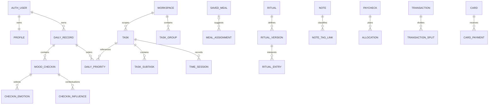

# Muse database and synchronization blueprint

**APPROVED ARCHITECTURE; LOCAL FOUNDATION IMPLEMENTED, APP CUTOVER PENDING.** Companion to the evidence-based [architecture audit](ARCHITECTURE_AUDIT.md). The subsequent approved Phase 1 brief authorizes the local foundation described in [PHASE1_LOCAL_SETUP](PHASE1_LOCAL_SETUP.md). Its two migrations, local Auth configuration, RLS tests and typed clients now exist. Hosted deployment and application authentication/persistence cutover remain unimplemented; later-module schema remains proposed. No production resources are authorized.

## Ownership and daily identity

One authenticated person owns private records. Workspaces are planning contexts, not organizations or additional auth tenants; Groups classify work within a workspace, while tags remain distinct. No speculative teams/permissions framework is needed for v1.

Use Postgres `date` for the chosen **user-local calendar date**, `timestamptz` for capture/edit/server timer instants, and a valid IANA timezone snapshot when capture/scheduling requires it. Profile timezone changes affect future defaults, not historical date identity. Do not derive old calendar days from timestamps displayed in a new zone. Week boundaries currently start Monday. Timed event entry needs explicit DST gap/fold handling before production; current local datetime strings cannot disambiguate this.

Diagrams omit owner/revision columns and many reference joins for readability. The tables below are the proposed contract, not copies of current component-local arrays.

## Conventions applying to every private table

- `id uuid primary key` generated client-side for idempotent creation (except natural composite join keys or profile keyed to auth). Imported prototype string IDs require an explicit mapping; keep a migration mapping until validation completes. Do not convert fictional fixture rows into personal records.
- `user_id uuid not null references auth.users(id) on delete cascade`; `created_at timestamptz not null default now()`, `updated_at timestamptz not null default now()`, `revision bigint not null default 1 check (revision>0)` on independently mutable entities. Update timestamp/revision server-side. Joins without independent lifecycle do not need redundant revision fields.
- Add `unique(user_id,id)` for owner-scoped composite references. Every private child FK uses `(user_id,parent_id)` → parent `(user_id,id)`; RLS alone does not prevent a guessed cross-owner reference from corrupting relationships.
- Field notation below: names/titles/notes/URLs/timezones/icons/reference labels are `text` (bounded at the API); owner/relationship IDs are `uuid` except canonical catalog IDs (`text`); local/anchor/due/effective dates are `date`; capture/edit/start/end instants are `timestamptz`; flags are `boolean`; positions/quantities/goals/macros are finite `numeric`; counts/small ratings are checked integers. Enum-like text has explicit closed-set checks. Fields with `?` are nullable; other listed domain fields are required unless the lifecycle description explicitly makes them optional.
- Mandatory values `NOT NULL`, optional facts `NULL`, not empty placeholders or sentinel zero. Trimmed names/titles have bounded lengths matching form contracts (task/meal160, reflection/note limits explicitly defined per endpoint). Stable reference IDs never depend on a mutable display name.
- Use index prefixes beginning `user_id` for private query paths. Index FK columns used in joins/deletes. Add named check/unique constraints so API errors can be mapped to useful field messages. Do not add an index to every optional field without a query.
- Money amounts are integer **cents**, no floating-point currency. Use bigint storage with a safe-integer API contract/checked serialization; aggregate totals must not silently overflow JavaScript. Currency approved USD-only v1, with explicit future currency context and no current FX support. Quantities/macros use finite nonnegative numeric values with bounded magnitude and precision, not NaN/Infinity.
- Archive referenced definitions rather than cascade-delete personal history. Hard deletes are explicit commands. Auth-account deletion is a separate audited/export-aware flow with approved retention policy, not a UI cascade exposed to other users.

## Daily and emotional records — first vertical slice

| Table | Fields beyond common ownership | Keys, constraints, indexes, lifecycle |
|---|---|---|
| `profiles` | `id` = auth.users PK; first_name; time_zone; optional zodiac_sign; validated preference document | One row/user, zone from server-approved IANA list, sign from canonical registry. Only own profile readable/writable. Profile is not a second identity/password table. Preferences contain only validated appearance/visibility defaults, not personal journals. |
| `daily_records` | `local_date date`, `time_zone text`, `intention_text text null`, `intention_emoji text null`, `day_in_three text[] not null default '{}'`, `energy smallint null`, `stress smallint null`, `overall_day smallint null` | `unique(user_id,local_date)`; each score null or1–10; array cardinality0–3, no null/empty entries; validate grapheme emoji strings at boundary (not string-length1). One authoritative daily record shared Daily/Mood/Dayprint/Insights. Capture original zone, never relabel date. Clearing a dimension sets NULL, clearing expression preserves unrelated data. |
| `mood_checkins` | `daily_record_id`, `period morning|evening`, `reflection text null`, `captured_time_zone text` | `unique(user_id,daily_record_id,period)`; stable session ID, no rating columns in clean target schema. FK owner/day, index(user_id,daily_record_id). Deleting a session removes its joins/reflection, **not daily Pulse/expression**. Preserve original created_at when editing at night. |
| `emotion_catalog` | stable text ID, name, emoji, quadrant, energy/pleasantness metadata, optional definition, reference version | Canonical reference, client read-only; quadrant enumerated, metadata validation. Keep existing IDs. No user ownership copied onto canonical rows. Favorites are separate owner/emotion joins if implemented. |
| `checkin_emotions` | checkin_id, emotion_id | PK(user_id,checkin_id,emotion_id); owner FK to checkin and canonical FK. Multiple feelings allowed. No stored duplicate name/quadrant per click. |
| `emotion_favorites` | emotion_id | PK(user_id,emotion_id), canonical FK; explicit preference, no emotional observation created. |
| `influence_tags` | label, archived_at optional | Owner label uniqueness by normalized active name; seed defaults idempotently per account only when approved. Archive preserves historical associations. |
| `checkin_influences` | checkin_id, influence_id | Unique pair and owner FK to both; max3 enforced in **transactional replace operation** with parent lock, not a racy count on the client. |
| `daily_priorities` | daily_record_id, text, task_id?, standalone_complete?, position smallint | Approved standalone-or-linked design. Add `text text not null`, `standalone_complete boolean null`, `task_id uuid null`, `position smallint`. position0–2; unique(day,position), partial unique(day,task_id) when linked. Owner FKs. Unlinked requires standalone_complete NOT NULL; linked requires it NULL and derives completion from tasks. Original commitment text remains dated. Atomic reorder/link/unlink, no task auto-creation; see lifecycle below. |

A small bounded array for Day in Three and structured JSON for prose/preferences are purposeful types. They do not justify an untyped “records” table containing every domain.

### Approved prototype replacement

Stephanie explicitly approved discarding the current memory-only prototype scores. Phase 1 starts with empty personal data: one authoritative daily Energy/Stress/Overall Day set, separate Morning/Evening emotional sessions, no fictional sample imports and no averaging/precedence conversion. No prototype records were imported by the local foundation. Existing app memory hooks remain until the coordinated application cutover.

If unexpected durable real data is discovered later, stop and preserve it; inspect conflicts before migration rather than extending the disposable-prototype permission to unrelated records. Update Daily Edit, Mood, Dayprint and existing Insights score readers together; do not duplicate daily ratings onto sessions to satisfy old types. Missing stays NULL.

### Daily priorities and Dayprint — approved shape, proposed lifecycle commands

Priorities are up to three daily commitments, either standalone or optionally linked to an existing Planner task. They are not Mood sessions. Import existing strings as **standalone commitments** with their real date/order/state; do not create tasks, fabricate completed_at timestamps, or require a Mood record. Linking is an explicit user action.

While linked, `setPriorityCompletion` delegates to canonical task completion in the same authorized transaction; the priority row has no competing stored completion value. `setTaskCompletion` invalidates every linked priority/day projection. Preserve the original editable commitment text; an updated task title may be shown as link context without overwriting the historical commitment. Reordering never changes identity.

Approved lifecycle: while linked, Planner owns live completion. Archive retains the link; moving the task never moves its original daily priority. Unlink/delete preserves the original commitment text, calendar date, slot and completion information. **Historical Dayprints must represent the completion state by the end of the associated day, not the task's current state after later completion.**

Later Planner proposal: record a small completion-transition history for linked priorities, including the baseline when linked. Use a server timestamp and the original daily timezone to resolve state strictly before the next local midnight (a DST day may be23/25 hours). Current-day views remain live. Persist the required historical facts when unlinking/deleting, so task deletion cannot cascade away the priority's history. A single mutable completed_at is insufficient after reopen/recomplete; no universal event log is needed.

Before implementing that slice, settle edge cases explicitly: task already complete at linking; linking to a past date with no earlier history (unknown, not fabricated); completion after midnight; reopen/recomplete on a later day; user-requested backdated correction versus normal capture time; unlink/delete before versus after the day boundary; historical timezone changes. Preserve recorded_at separately if an explicit effective-date correction is approved. This history/Planner integration is **not implemented in Phase 1**. Standalone completion capture is timestamped by the database; a dated manual status is not proof of a workout/task event at that instant.

Dayprint is a **query/presentation**, not a table: daily record + priorities with optional task-status join + dated emotional sessions. Its date inventory must include priority-only and intention-only days. It shows intention/emoji, ordered priority text/status/count, Day in Three and daily Pulse, then properly labeled Morning/Evening feelings/influences/reflections. Editing any source invalidates the same day's Dayprint. Missing sections stay absent. No requirement to create a Mood check-in just to preserve intention or priorities.

## Planner and movement

| Table | Fields | Integrity and query paths |
|---|---|---|
| `workspaces` | name, accent token/custom validated color, icon_id, archived_at? | Unique active normalized name/user; preserve referenced rows; list(user_id,archived_at). Not auth tenancy. |
| `task_groups` | workspace_id, name, accent?, icon_id?, archived_at? | Owner workspace FK, unique active normalized name/workspace. Add unique(user_id,workspace_id,id) for a task's same-workspace group reference. |
| `task_tags` / `task_tag_links` | tag name/accent/icon/archive; task_id/tag_id join | Owner FKs, unique pair; tag/user normalized name uniqueness. Match-all tag filter indexes both task and tag lookup. |
| `tasks` | title, workspace_id, group_id?, planned_date?, due_date?, local_time_slot?, estimated_minutes?, actual_minutes_baseline numeric default0, completed_at?, complete boolean, notes?, detail?, position numeric, recurrence_frequency?/interval?/until? | Owner workspace/group constraints; group belongs to task workspace. date columns true dates; estimate≥0; complete/completed_at import policy allows unknown legacy instant but new commands timestamp completion. Index(user_id,planned_date,position,id), partial unscheduled(user_id,workspace_id,position), due-date index only for actual query. Optional recurrence fields must form a valid bundle; no automatic instance generator yet. |
| `task_subtasks` | task_id, title, complete, position | Ordered unique/task position; owner FK; deleting task cascades its actual children. |
| `planner_events` | title, local_date, local_time?, time_zone, starts_at?, ends_at?, detail? | Separate from tasks; date/user index. Resolve timed entries in IANA zone; ends≥starts when supplied, do not invent duration from a display string. No completion state. Define untimed event semantics before adding editor fields. |
| `task_time_sessions` | task_id, started_at, ended_at?, elapsed_seconds?, imported_source? | Partial unique index(user_id) WHERE ended_at IS NULL permits one running timer/user. Server validates elapsed; active interval has null end, pause/stop closes it. Index(user_id,task_id,started_at), range queries by instants/local reporting zone. Do not create fake sessions from old actualMinutes totals. |
| `movement_types` | label, origin starter|custom, archived_at? | Owner library, stable ID, normalized label uniqueness. Preserve historical links on archive. |
| `movement_days` / `movement_day_types` | local_date, captured_time_zone; day_id/type_id join | unique(user_id,local_date) plus unique pair. Explicit recorded-empty vs absent day distinguishable. Selection expresses intention, not confirmed exercise. Shelf max5/recency are preferences, not a second movement log. |

Task commands: `captureTask`, `updateTask(expectedRevision)`, `setTaskCompletion`, `moveTask`, `reorderDay`, `setTaskClassification`, `startTimer`, `pauseTimer`, `deleteTask`. Same command from Daily or Planner. Drag sends a move/reorder intent; completion does not change on move. Parent/day ordering transaction locks or CAS on ordering version; use spaced numeric positions with bounded rebalance, not whole-array last-write-wins. Task workspace changes clear/require a compatible group atomically.

Time control uses a database transaction locking the user's active timer, closing prior interval and opening a new one once. Server time, not an untrusted browser clock, determines durable duration. API total = imported/manual baseline + valid closed intervals + running duration, preserving existing actual-minute semantics. Decisions about manual correction and completion/reopen remain explicit; idempotency tokens prevent duplicate starts/retries. No event-sourced universal activity log.

## Rituals

| Table | Fields | Constraints/lifecycle |
|---|---|---|
| `ritual_groups` | name, accent, icon_id, optional validated gradient, sort_order, archived_at? | Owner-scoped unique active name. Collapse is a preference, not adherence history. |
| `rituals` | group_id, name, archived_at? | Stable ritual identity. Renaming/group change does not rewrite old values; archive retains entries. |
| `ritual_versions` | ritual_id, effective_from date, effective_to date?, type, goal numeric, unit?, recurrence daily|weekly|weekdays, weekdays smallint[], start_date | No overlapping effective ranges per ritual (exclusion constraint or serialized command); weekday0–6 unique; daily checkbox goal1, numeric/duration goals>0, weekly target separate semantics. A historical edit is validated against its original version. |
| `ritual_entries` | ritual_id, version_id, local_date, value numeric, outcome recorded|missed, captured_time_zone | unique(user_id,ritual_id,local_date); owner/version association; value finite≥0; explicit missed has0. Clear deletes the observation. Reject future and non-scheduled daily entries; weekly-target logs valid within active week without manufacturing seven daily obligations. Index(user_id,local_date), ritual/date. |

Compute Complete, Partial, explicit Missed, Unknown, Not Scheduled, Upcoming from original schedule, date and observation. A missing row is not an explicit failed entry. Streaks and denominators use scheduled opportunities; Tue never breaks Mon/Wed/Fri recurrence. Weekly-target streaks count eligible weeks and use sum of quantities. Define how historical unknown affects an active streak separately from explicit missed. Existing functions are the starting specification, with fixture tests across boundaries. Persist logs, not calculated streak counters or animation playback keys. Goal/type/schedule edits create effective-dated versions after initial logs rather than reinterpreting history.

## Nourish, hydration and shopping

| Table | Fields | Constraints/lifecycle |
|---|---|---|
| `saved_meals` / `saved_meal_types` | name, note?, link?, calories?/protein?/carbs?/fat?; meal_id/slot join | unique active normalized name/user; known macros finite≥0; slots canonical; missing distinct from0. Owner references; saved meal remove may detach existing assignment refs. |
| `meal_assignments` | local_date, slot, title, note?, saved_meal_id?, calories?/protein?/carbs?/fat?, position | Date/slot/order index; nullable reference uses owner-safe explicit detach on saved deletion. Occurrence snapshots retain title/note/macros; template edit never rewrites previous meals. No recipe table just to support unused legacy recipeId. |
| `hydration_days` | local_date, quantity numeric, goal numeric, unit oz|ml, captured_time_zone | unique(user_id,local_date), quantity≥0, goal>0. Store the applicable goal/unit snapshot; all surfaces use it for historical attainment. No amount conversion by relabeling units. No drink-event table until actual per-drink history is approved. |
| `hydration_settings` | default_goal, unit, quick_adds numeric[] | One/user, positive goal/adds, bounded list. Future changes apply prospectively; explicitly changing a past target is a dated update, not a global rewrite. |
| `grocery_sections` | stable key, name, position, archived_at? | Seed common categories idempotently; current category model preserved, full management is separate scope. |
| `grocery_items` | name, quantity text?, note?, section_id, complete, position | Owner section FK; operational list index(user_id,complete,section_id,position). No inference of intake/purchase from check state. |

Assignments move atomically (same ID/new date/slot/order); copies use new IDs and an idempotent batch command. Macros stay snapshots even if library changes. Undo grocery removal can restore a tombstoned row within a short retention window or use a versioned restore command; select one deletion policy before implementation. Never restore over someone else's later edit. A list/container table is only needed when multiple named shopping lists become real scope; v1 can query owner-scoped items.

## Money: normalized records, existing math retained

All rows are owner scoped. Money code in [lib/money.ts](../lib/money.ts) and recurrence in [lib/recurring.ts](../lib/recurring.ts) are the current calculation contract. No calculation change is implied by normalization.

| Tables | Required fields and relationships | Constraints / indexes |
|---|---|---|
| `money_categories`, `money_subcategories`, `money_tags`, `allocation_groups`, `payment_methods` | name, appropriate accent/icon, archived_at; subcategory.category_id; method kind | Unique active normalized names within owner/parent. Owner-safe category/subcategory composite FK; archive referenced classifications. Not Planner workspaces/groups. |
| `paychecks` | name, received_date, period_start/end, expected_cents?, actual_cents?, note?, template_id? | Period end≥start; nullable cents≥0; index(user_id,received_date), reporting period overlap. |
| `allocations` | paycheck_id, name, planned_cents, actual_cents?, allocation_group_id, category_id?, subcategory_id?, due_date?, bill_id?, card_id?, note?, position | Owner FKs, nonnegative amounts; card/bill link compatibility validated; index(user_id,paycheck_id,position). Actual NULL means derive/unknown, 0 means explicit known0. |
| `paycheck_templates`, `paycheck_template_allocations` | template name/expected_cents?; child defaults name/group/category/card/bill/planned_cents/note/order | No actuals, paycheck identity or copied historical due date in defaults. Apply transaction creates new IDs once. Validate default links as thoroughly as allocations. |
| `transactions`, `transaction_splits`, `transaction_tag_links` | merchant, amount_cents, local_date, category/subcategory?, payment_method_id?/legacy payment label, card_id?, allocation_id?, note?; splits amount/category/subcategory; tags join | Amounts≥0; splits sum≤transaction amount in locked transactional replace; remainder Unassigned; reject cross-owner/incompatible allocation links. Index(user_id,local_date), card/date, allocation. Unique joins. |
| `cards` | name, balance_cents signed, limit_cents?, apr?, due_date?, minimum_cents?, planned_payment_cents?, note?, opening_balance_cents, opening_as_of | Signed balances permit credit; nonnegative limits/payment minima; APR finite≥0 with explicit percentage unit. Opening balance and effective date must be explicitly established by the user; never infer them from incomplete transactions. |
| `card_payments` | card_id, amount_cents, local_date, paycheck_id?, allocation_id?, note? | Positive payment amount, owner FKs, matching card allocation; index(user_id,card_id,local_date). A payment is not a spending transaction. |
| `bills` | name, amount_cents, due_date, recurrence once|weekly|monthly|yearly, category_id?, card_id?, paid, note?, recurring_commitment_id? | Due/user/status index; paid is a status, no automatic synthetic expense. A recurring occurrence materialization policy requires separate approval. |
| `recurring_commitments` + `recurring_versions` | name/status; effective range, amount_cents?, fixed_or_estimated, anchor_date, interval_count, interval_unit day|week|month|year, billing_source, payment_method_id?/label, card_id?, category_id?, notes?, manage_url?, ends_on? | interval>0, valid ranges, no overlapping versions; cancelled/paused differs from paid; index(user_id,status,anchor_date). Keep original calendar anchor for Jan31→Feb→Mar. Forecast totals and normalized monthly equivalents stay explicitly different from actual charges. |

Transactions/payment create, edit, card change and delete must be **one database transaction**: verify owner/links/revision, reverse previous card effect, apply new effect, replace splits/tags, bump revisions and return authoritative affected rows. Lock card IDs in stable order to avoid deadlocks. An idempotency key/result record scoped to this command prevents retry double-application; it stores operation identity/result, not a duplicate universal personal-data log. CAS rejects stale edits. Reconcile opening balance + validated post-baseline deltas; retain current balance for efficient display only with atomic integrity. Define adjustments/refunds/foreign currencies separately before expanding input semantics.

Allocation actual logic remains: explicit actual overrides; otherwise linked amounts derive actual, with no observations remaining unknown. Card-payment allocations derive payments, not card spend. Never aggregate both purchases and payments as expenses. Cross-record edits that would invalidate existing links are rejected or resolved explicitly, not silently detached. Historical balance series need approved baseline and actual dated deltas; don't backfill fictional snapshots or claim current card balance is past balance.

## Notes and search

| Table | Fields | Integrity/lifecycle |
|---|---|---|
| `notes` | title, document jsonb, server-derived plain_text/search_vector, status active|archived|trashed, trashed_from?, pinned, trashed_at?, revision | Tiptap schema validation, allowed nodes/marks/URL protocols, bounded payload. GIN search_vector and indexes(user_id,status,pinned,updated_at). Do not trust client plainText independently of content. |
| `note_tags` / `note_tag_links` | canonical path, parent_id?, display segment/icon/pinned, note_id/tag_id join | Unique(user_id,path), same-owner parent, prevent cycles; transactional subtree rename/reparent with collision checks, stable IDs. Deleting branch clears joins, never notes. |
| Optional later `note_versions` | note_id, source_revision, saved document/title, reason, captured_at | **Not needed for initial storage** unless meaningful save/history UX is approved. Not every keystroke. Owner retention/export/delete rules required. |

CAS `saveNote(id,expectedRevision,document,title)` returns new revision; on conflict preserve local draft and offer reload/keep-copy/explicit compare. Archive/pin/tag changes must participate in a defined revision strategy too. Debounce is a network optimization, not durability; expose pending/error/saved state. Draft recovery may use per-user scoped local storage after privacy approval; logout must clear it. No new collaborative editor framework or remount of Tiptap. Full-text queries remain scoped to owner/current view/tags, with cursor pagination. Descendant tag filtering uses canonical path/parent relations, not unescaped wildcard input.

## Authentication, RLS and server boundary

Approved v1: private invite-only email magic-link authentication with admin-managed invitations. Disable public signup in Auth configuration; `shouldCreateUser:false` on OTP requests is additional client behavior, not the security boundary. Use generic request responses/rate limits, configured redirect allowlist, verified PKCE/OTP callback and safe relative return path; no open redirects. Preview login remains separate until a real approved login slice replaces it.

Supabase's current Next.js guide uses browser/server SSR clients and a Proxy for cookie refresh; it recommends verified `getClaims()` for protection and `getUser()` when a current Auth-server record is needed. Recheck installed Next 16 documentation and Supabase package versions during implementation. Proxy is not the sole authorization layer; validate identity/permissions in every private read/mutation and enforce RLS in Postgres. Never trust the `getSession()` user object alone for authorization. See [official SSR client guide](https://supabase.com/docs/guides/auth/server-side/creating-a-client) and [official Next.js tutorial](https://supabase.com/docs/guides/getting-started/tutorials/with-nextjs).

For every private table: enable RLS; grant only required operations to authenticated; SELECT/DELETE `using ((select auth.uid())=user_id)`; INSERT `with check` same owner; UPDATE both `using` and `with check`. Profiles compare auth UID to profile PK. Join rows enforce ownership of both sides via composite FKs and policy. Canonical vocabulary may be readable to authenticated users, writable only via controlled migrations/admin boundary. Anonymous cannot read private rows. RLS doesn't replace checks/FKs or explicit column/command permissions. [Official RLS guidance](https://supabase.com/docs/guides/database/postgres/row-level-security).

Keep views `security_invoker=true` where exposed so caller RLS applies; don't expose a default definer view over private tables. [Official views guidance](https://supabase.com/docs/guides/database/views). Functions use invoker rights by default. Any justified security-definer transactional helper must fix search_path, explicitly check auth.uid(), validate ownership, restrict grants/revoke public execution and have negative tests; no arbitrary user_id argument granting access. Service role never enters browser bundles or ordinary user queries. Secrets live in deployment configuration; public URL/publishable key do not bypass RLS.

No private response enters shared Next `use cache` without a proven user-scoped policy; prefer request-bound authenticated reads for the first slice. Logout/account switch cancels requests, clears private query/draft caches and re-establishes scoped providers before displaying records. Auth failure is not rendered as a genuine empty library. Apply CSRF/origin protections for cookie-authenticated mutation endpoints and enforce server-side payload validation regardless of UI controls.

## Proposed implementation file boundaries (future work only)

- `lib/supabase/client.ts` and `server.ts`: browser/request-scoped SSR clients, generated `lib/database.types.ts`; a narrow cookie-refresh helper for a future root `proxy.ts`. No client-importable service secret.
- `lib/server/auth.ts`: server-only verified identity and safe redirect helpers. A private route-group layout can provide the authenticated shell, with request-time session reads streamed under a deliberate Suspense boundary; actions/repositories still authorize independently. Route protection is not just a retained client layout check.
- `lib/data/<domain>.ts`: typed bounded read/command interfaces and runtime adapters. `lib/queries/keys.ts` / shared query provider own user/date/range cache identity; existing pure `lib/*` calculations remain reusable.
- `supabase/migrations/`: reviewed schema/RLS/function changes in dependency order; `supabase/tests/`: ownership/constraint/transactional tests. These folders are proposed, not created by this audit.

The installed Next 16.4.3 guide `node_modules/next/dist/docs/01-app/02-guides/authentication-with-cache-components.md` explains that request session reads cannot be prerendered into a static shell. Design explicit loading/Suspense boundaries when adding auth to this Cache Components app. Do not suppress dynamic-data errors with obsolete placeholders or put cookie/token reads in a public cache. Authenticated server reads start request-bound; any later cache scope requires explicit user keys and security tests. No authentication code is added here.

## Data access, query cache and invalidation

Proposed small typed repository/command layer per domain with generated DB types, runtime validation at boundaries and pure existing calculation functions. UI calls intent-level commands, not ad hoc table updates from every card. Reuse components and validators; replace the memory owner domain-by-domain. Do not keep reducers and database queries as two independently editable authoritative sources.

A shared client query cache (candidate TanStack Query, **not installed/approved by this audit**) handles pending/error/saved state and mutation invalidation; cache keys include authenticated user ID, domain, local date/range/workspace/filter. Server-seeded queries and client queries must use the same identity/key. Pure projections compose canonical rows; there is no dashboard table. Paging/range limits replace loading all history for every page. Transient draft/filter/open-menu state stays local; appearance preferences can save after authenticated hydration without flashing defaults over a stored choice.

| Command | Invalidate/replace authoritative results |
|---|---|
| Standalone/linked priority edit/complete/link/unlink | daily priorities and Dayprint/date inventory, task row when linked, Daily Edit counts and future completion-trend queries; preserve original day when task moves |
| Daily expression or Pulse set/clear | daily(user,date), Daily Edit, Mood/Dayprint/history and applicable Insights range; never mutate a session score copy |
| Emotional session create/edit/delete | session/date history, Mood summary, Daily feeling projection and relevant Insights; daily expression survives session deletion |
| Task completion/edit/delete/move/reorder | task row, old+new dates, workspace unscheduled pool, linked priority projection, timer total and affected Insights; old-date invalidation is mandatory |
| Meal assignment/save/copy/move | both source/destination days, daily nutrition coverage/totals, recent suggestions; saved-library queries only when library changed |
| Hydration/movement update | dated record and relevant Daily/Nourish/Insights ranges; library archive never erases past observations |
| Ritual log/version/archive | ritual rows, eligible week/date ranges, summaries/streaks/Insights; recompute affected future/historical range from actual version dates |
| Money transaction/payment/plan edit | command returns all touched balances/linked actuals; invalidate ledgers, cards, allocations, period summaries/Insights together after atomic commit |
| Note edit/tag/status/delete | note/revision, list/search/count/tag descendants, draft resolution; preserve editor DOM/caret rather than remount on refetch |

Simple idempotent optimistic toggles can update shared cache immediately, with mutation-specific snapshots and rollback conditioned on revision. Never restore an entire stale cache over later edits. Financial multi-row changes wait for authoritative transaction results. Failed saves retain draft, show error/retry, and do not present false durable success; offline writes have no guaranteed queue in initial v1. Retry only idempotent requests with bounded backoff, distinguish validation/401/403/409/network failures.

Initial cross-device consistency: server is authoritative; refetch on focus/reconnect, after successful writes and navigation. Cross-tab invalidation can broadcast only resource IDs/version notices, not private bodies; receiving tabs refetch as authenticated users. Optional scoped Realtime invalidation for active dates/entities may follow after correctness tests; don't subscribe every user to all tables. Concurrent writes use expectedRevision and transactions, not last-write-wins prose or client timestamps. Avoid refetch replacing an unsaved focused draft; show conflict rather than silently resetting it.

## Historical integrity and future analytics

Persist meaningful observations and necessary version relationships, not every interaction. Preserve original local date/timezone and creation timestamp on edit; update timestamp indicates modification. Domain versioning is justified for Ritual schedules, recurring terms, real timer intervals and card balance baselines. Task rescheduling history is not currently captured: add targeted plan-change history only if an approved historical-planning analysis needs it, not a universal event log. No stored chart copies or fake backdated seeds.

Every query defines unit/denominator: days for daily Pulse, sessions/selections for feelings, scheduled opportunities for rituals, known planned macros for meals, quantities/goal snapshots for hydration, transactions vs payments vs future commitments for Money. Optional missing values stay absent. Do not let joins multiply transactions by split/tag rows or moods by feelings when computing score averages. Deletion/clear invalidates derived caches; derived data must respect owner permissions and sensitive text exclusion. See audit inventory for current analytical coverage and gaps.

## Future Whimsy compatibility — no tables now

Preserve these extension boundaries from [WHIMSY_ROADMAP](WHIMSY_ROADMAP.md): stable canonical references distinct from user records; local dream/waking/draw/reading dates distinct from capture timestamps; original interpretation/reference version when meaningful; optional explicit day associations; strong journal privacy/export/delete; deliberate sensitive-excerpt permissions. Tarot reference/deck rights and learning progress differ from personal draws. Dream associations aren't waking Mood by default. A saved fortune differs from a shown fortune. Reading status history is needed before reconstructing old current books. Forecast/facts/weather are sourced caches, not private activity logs; choose provider, TTL, attribution and retention only during a real feature slice.

Evening at a Glance should be a derived, permission-aware projection of source IDs and real dated records, not another permanent daily score/summary table. No precreated tarot/dream/fortune/weather tables, generalized widget system, universal event store or horoscope API belongs in this task.

## Migration / release plan and future tests

1. Approve decision gates in the audit. Inventory prototypes/export optional user-entered session data; explicitly exclude fiction. Confirm import consent and ability to map every foreign key.
2. In a later authorized branch create versioned local Supabase migrations for schemas/constraints/RLS/indexes/functions and generated types. Review SQL before apply; test locally with two users/anon, not production credentials. No SQL has been executed in this audit.
3. Implement auth/profile/daily/Mood end-to-end first; verify one daily Pulse and separate sessions on Daily/Mood/Dayprint/Insights. Run migration dry-run/count/roundtrip checks before removing old fields. No mixed old/new score reads.
4. Replace remaining owners in bounded domain slices (audit ordering), preserving shared components, command contracts, calculations and draft behavior. Use real load/error states; never present sample fallback as real empty/user data after login.
5. Validate refresh/device persistence, concurrency/idempotency, RLS/fk negatives, temporal history, archive/delete/export, query bounds and performance. Add recovery/backup process before real personal use. Feature flags must not create two writable truths.

Required future tests: userA cannot read/write/link userB rows, anonymous access denied, crafted RPC userID ignored/rejected, security-invoker views safe; daily unique/rating null/Day in Three max3/influence max3 under concurrency; two sessions keep identity when edited at different times; lossless Pulse conflict resolution; query rollback vs newer write; note revision conflicts/structured-content validation; duplicate timer start; drag ordering concurrently; month-end recurring anchors; Ritual schedule versions/missing/missed/unscheduled distinctions; copied meal snapshot immutability; atomic transaction/payment balance reversals and safe split sums; unit conversion cannot rewrite historical hydration; DST/cross-midnight local dates; signout cache removal; no sensitive excerpts without consent. These are acceptance criteria, **not tests claimed to pass before the backend exists**.

## Approved retention and travel policies

Retain personal records until explicit deletion under the approved lifecycle. Session deletion preserves independent daily data. Working user-controlled export and confirmed account deletion, including relevant cache clearing, are required **before real personal-data use**; expanded trash/recovery can follow. The local foundation verifies database cascades and privileged Auth deletion with synthetic users, but does not yet expose those user-facing privacy controls. Document actual backup retention when an environment is selected; deletion from live storage is not a promise of instant erasure from retained backups.

Use the stable, user-configurable profile timezone for Today/session defaults. Device travel never switches it automatically. Intentional changes affect future defaults and preserve already selected/history dates and capture context. UTC timestamptz values represent instants; local_date represents the chosen calendar day. Timed Planner DST ambiguity handling remains later scope. Local configuration is development-only and not evidence of hosted readiness.
